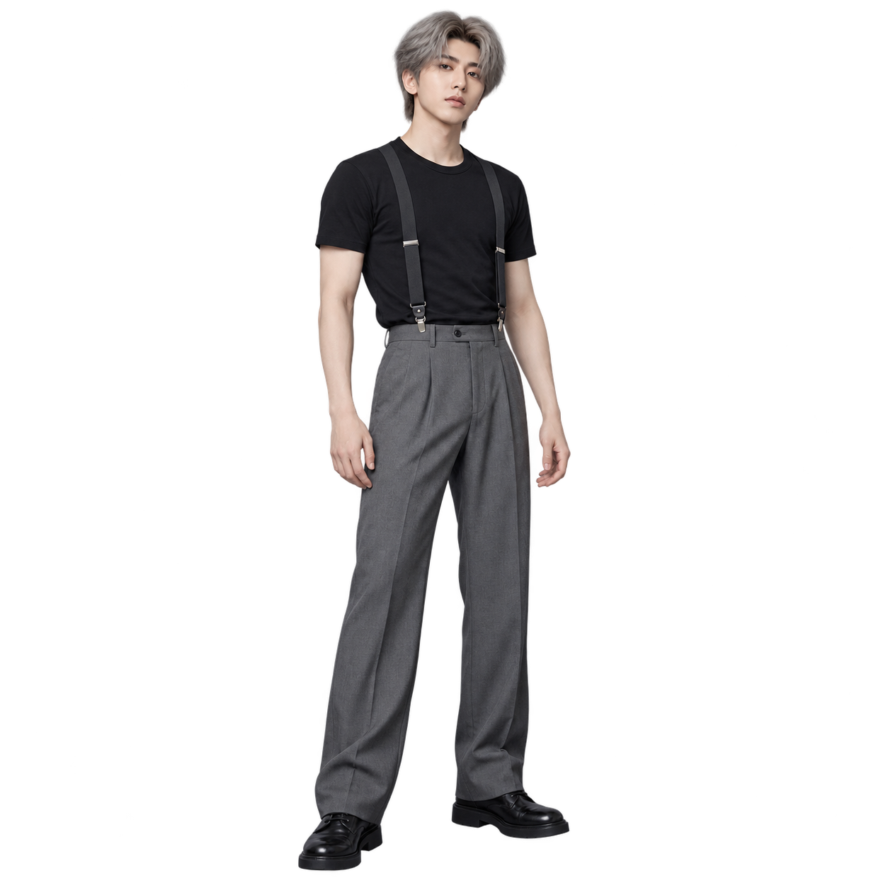
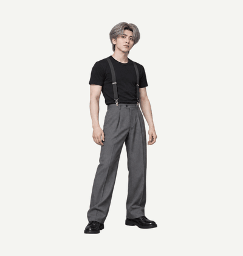

# Character Sprite Loop · 角色创建与透明循环帧

A Codex skill for creating a character, confirming its master image, and producing transparent animation loops. Includes a standalone PNG/APNG packer and an offline frame preview.

先创建角色，确认母版，再制作透明循环动作帧。也支持直接使用已有角色，或只创建角色。

调用名：`$character-sprite-loop`。界面名称：**角色创建与透明循环帧**。

## 动画案例：角色母版 → 透明循环

以下为 **AI 生成的蔡徐坤转身顶肩动作演示**，无篮球。25 帧，每帧 200 毫秒，每轮 5 秒。

| 已确认的角色母版 | 循环动作预览 |
| --- | --- |
|  |  |

动作阶段：准备 → 转身 → 蓄力 → 顶肩 → 回收 → 复位。

[下载透明 APNG 原文件](docs/demos/cai-xukun-shoulder-turn.apng) · [查看透明角色母版](docs/demos/cai-xukun-master.png)

GIF 使用浅色底方便阅读；APNG 和母版保留透明背景。帧数、时长和 APNG 解码时序已验证。此案例为用户选定的效果演示，仍有细微脸部、服装和脚位变化，未完成连续两个循环的视觉验收，不作为无缝或原舞蹈精确复现的证明。

非官方 AI 演示，非真人拍摄，不代表本人参与、授权或代言。演示图片与动画不纳入代码的 MIT 许可，详见[素材说明](docs/demos/NOTICE.md)。

## 能做什么

- 根据描述创建完整角色，在用户确认后保存母版及角色说明。
- 围绕同一母版设计关键姿势、分批补帧，并检查角色身份、步态、接触关系和首尾衔接。
- 保留真实 alpha 透明，区分设计镂空与白色眼睛、衣服等实体部位。
- 将独立 PNG、等分网格或指定裁切布局封装为 PNG 序列、精灵图、APNG、离线预览和 ZIP。

Skill 提供制作规则；实际图片生成需要运行环境提供图像生成及参考图编辑工具。本仓库不包含生成模型、API 密钥或第三方图片服务。Python 导出脚本可以独立使用。

## 安装 Skill

将仓库或 [Release](https://github.com/SalamancaDu/character-sprite-loop/releases) 中的 `character-sprite-loop` 文件夹放到 Codex 的 `skills` 目录。目录内应直接包含 `SKILL.md`。

Windows PowerShell（目标目录尚不存在时）：

```powershell
$skillRoot = if ($env:CODEX_HOME) { Join-Path $env:CODEX_HOME 'skills' } else { Join-Path $env:USERPROFILE '.codex/skills' }
git clone https://github.com/SalamancaDu/character-sprite-loop.git (Join-Path $skillRoot 'character-sprite-loop')
```

macOS / Linux：

```sh
git clone https://github.com/SalamancaDu/character-sprite-loop.git "${CODEX_HOME:-$HOME/.codex}/skills/character-sprite-loop"
```

已有同名安装时先保留个人修改，再更新对应目录，不要直接覆盖自定义内容。

## 使用示例

```text
使用 $character-sprite-loop，先创建一个黄色滑稽的人形角色，
让我确认后，再制作 25 帧向右奔跑的透明循环。
```

```text
使用 $character-sprite-loop，用我提供的角色图制作擦汗并走路循环。
保留白色眼睛，背景透明，手要经历抬起、擦拭和放下的完整动作。
```

```text
使用 $character-sprite-loop，只创建一个绿色像素机器人，
先给我一张全身透明 PNG，不生成动画。
```

普通奔跑允许自然腾空；如果需要贴地、不跳、固定方向或指定帧数，请在请求中说明。角色已明确选定后，不重复索要确认。关键姿势由模型检查，保留用户指定的审阅节点。

## 独立使用导出脚本

需要 Python 3.10+ 和 Pillow；浏览器预览不需要服务器或 Node.js。Node.js 仅用于开发时的播放逻辑测试。

在仓库目录安装依赖，推荐使用虚拟环境：

```sh
python -m venv .venv
# 激活 .venv 后执行：
python -m pip install -r requirements.txt
```

独立帧命名为 `frame_01.png`、`frame_02.png`……；输出目录必须是新目录：

```sh
python scripts/pack_frames.py --frames-dir ./input-frames --count 25 --columns 5 --frame-ms 60 --output-dir ./output/run-v1 --require-distinct
```

已检查的等分网格：

```sh
python scripts/pack_frames.py --sheet ./sheet.png --columns 4 --rows 3 --count 12 --frame-ms 100 --output-dir ./output/run-v2
```

非等分布局：

```sh
python scripts/pack_frames.py --sheet ./sheet.png --layout ./layout.json --count 2 --columns 2 --frame-ms 100 --output-dir ./output/run-v3
```

`layout.json` 示例，坐标需按真实图片填写：

```json
{
  "canvas": [360, 360],
  "frames": [
    {"crop": [10, 10, 180, 260], "paste": [90, 40]},
    {"crop": [205, 15, 385, 265], "paste": [85, 40]}
  ]
}
```

`crop` 是原图像素坐标 `[左, 上, 右, 下]`，右、下不包含；`paste` 是裁片在输出画布的左上角坐标。列表顺序即播放顺序。布局模式不能使用 `--rows`，`--columns` 仅控制输出精灵图排列。脚本不缩放、重绘或自动删除背景。

输出内容：

| 文件 | 用途 |
| --- | --- |
| `frames/frame_*.png` | 统一画布的透明独立帧 |
| `sprite-sheet.png` | 透明精灵图 |
| `loop.apng` | 按指定帧间隔无限循环的 APNG |
| `preview.html` | 离线播放、暂停、逐帧及浅深背景切换 |
| `preview-white.png` | 带帧号的白底联系图 |
| `frames.zip` | 仅包含独立 PNG 的压缩包 |

双击导出的 `preview.html`，保持它与 `frames/` 相邻。若运行平台禁止打开本地网页，可在允许的本地浏览器中自行打开。该页面默认暂停，不会自动播放。

## 验证与限制

脚本验证画布、真实透明像素、重复帧和 APNG 解码时序，但无法判定角色是否走样、步态是否自然或循环是否无缝。`--require-distinct` 只检查图片是否不同；有意设计的停顿帧可省略该参数。

生成动作后仍需逐帧检查，并连续观看至少两个循环。已知造型、接触或首尾问题未解决时，应标记为草稿。多帧网格生成不保证自动得到连贯动作。

## 开发与测试

测试使用代码构造的小型 RGBA 样本，不需要私人素材、图片生成服务或密钥。

```sh
python -B -m unittest discover -s scripts -p "test_*.py" -v
node --test scripts/test_preview.cjs
```

播放逻辑测试需要 Node.js 20+，不安装 npm 包。它模拟时钟及页面事件，不代表真实浏览器渲染已经验收。

可选：将 `SPRITE_TEST_FRAMES` 环境变量设为已有 25 帧目录，用真实图片运行同一组封装检查。默认使用合成测试样本。

GitHub Actions 配置在 Windows、Linux 和 Python 3.10 / 3.13 上运行测试；实际运行结果以仓库 Actions 页面为准。

## 许可与素材

代码、文档和预览模板采用 [MIT License](LICENSE)。仓库包含用户选定的 AI 动画展示素材；这些素材不纳入 MIT 许可，见 [素材说明](docs/demos/NOTICE.md)。测试样本由代码构造。用户自行提供的参考图和生成结果不因使用本仓库而自动获得 MIT 许可。

技术参考：[GitHub 官方 Actions](https://github.com/actions)、[MIT 许可原文](https://opensource.org/license/mit)。
